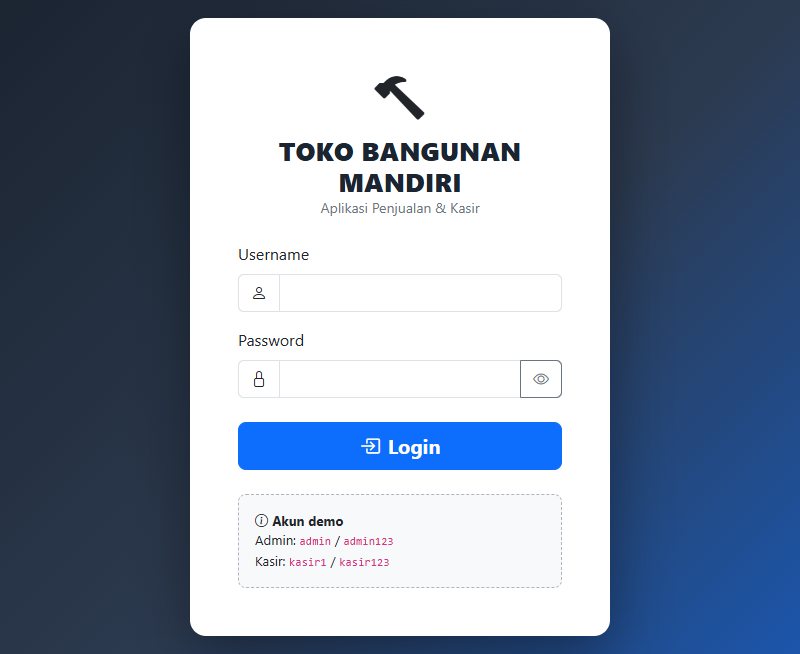

# 🏗️ Toko Bangunan — Aplikasi Penjualan (POS)

Aplikasi kasir &amp; manajemen toko bangunan berbasis web: input penjualan cepat,
stok berkurang **otomatis**, struk siap cetak, laporan + grafik, serta halaman
pengaturan nama toko &amp; manajemen user.

> Dibuat dengan **HTML + Bootstrap 5** (tampilan), **PHP** (server/API),
> dan **MySQL** (database).

---

## 🖼️ Tampilan Aplikasi

### 1. Halaman Login
Satu pintu masuk untuk admin &amp; kasir. Password tersimpan terenkripsi (hash).



### 2. Dashboard
Ringkasan harian: total produk, pendapatan hari ini, jumlah transaksi,
**peringatan stok menipis**, dan grafik penjualan + barang paling laris.


### 3. Kasir (POS)
Cari barang → masuk keranjang → isi diskon &amp; uang bayar → kembalian
terhitung otomatis → cetak struk. Satuan mengikuti barang (sak/pcs/batang/meter).


### 4. Manajemen Produk
Daftar seluruh material: harga beli/jual, stok (badge merah = menipis),
supplier, serta tombol tambah/edit/hapus.


### 5. Pengaturan &amp; User (khusus admin)
Edit **nama/alamat/telepon toko** (otomatis dipakai di seluruh aplikasi dan struk),
kelola akun user beserta **level**-nya.


---

## ✨ Fitur

| Fitur | Keterangan |
|---|---|
| 💰 Kasir (POS) | Pencarian barang, keranjang, diskon, kembalian, cetak struk 80mm |
| 📦 Manajemen Produk | Satuan bervariasi: sak, pcs, batang, meter, dus, kg, liter, roll, m², m³ |
| ⚡ Stok otomatis | Stok berkurang sendiri saat transaksi (Trigger SQL), kembali bila dibatalkan |
| 👥 Pelanggan | Pembeli umum, reguler, atau kontraktor |
| 📊 Dashboard &amp; laporan | Omzet hari ini, grafik 7/14/30 hari, barang terlaris, stok menipis |
| 🔐 Manajemen user | Tambah/edit/hapus akun + level (admin / kasir) |
| 🏪 Identitas toko | Nama, alamat, telepon otomatis dipakai di login, sidebar, dan struk |

---

## 🚀 Cara Menjalankan (dengan XAMPP)

> Aplikasi ini butuh **XAMPP** (yang menyediakan Apache, PHP, dan MySQL).
> Belum punya? Unduh gratis di <https://www.apachefriends.org>.

1. **Install lalu buka XAMPP** → klik **Start** pada `Apache` dan `MySQL`.
2. **Salin folder project ini** ke:
   ```
   C:\xampp\htdocs\TokoBangunan
   ```
3. **Buat databasenya** (sekali saja):
   - Buka browser → `http://localhost/phpmyadmin`
   - Menu **Import** → pilih file `db_tokobangunan.sql` → klik **Import**.
   - Selesai! Database `db_tokobangunan` beserta tabel, data contoh, dan
     trigger stok otomatis langsung terbentuk.
4. **Buka aplikasinya**:
   ```
   http://localhost/TokoBangunan/login.html
   ```
5. Login menggunakan akun demo di bawah. 🎉

> Punya database lama dari versi sebelumnya? Jalankan saja `upgrade_v2.sql`
> untuk menambah tabel pengaturan tanpa merusak data.

---

## 🔑 Akun Demo

| Level | Username | Password |
|---|---|---|
| Admin (akses penuh) | `admin` | `admin123` |
| Kasir (hanya kasir) | `kasir1` | `kasir123` |

### Hak akses per level

| Aksi | Admin | Kasir |
|---|:---:|:---:|
| Transaksi kasir / cetak struk | ✅ | ✅ |
| Lihat dashboard &amp; daftar produk | ✅ | ✅ |
| Tambah/edit/hapus produk | ✅ | ❌ |
| Pengaturan nama toko | ✅ | ❌ |
| Tambah/edit/hapus user | ✅ | ❌ |

---

## 📂 Struktur Folder

```
TokoBangunan/
├── login.html              # Halaman login
├── dashboard.html          # Ringkasan + grafik (Chart.js)
├── kasir.html              # Transaksi kasir + struk
├── produk.html             # Master produk (CRUD)
├── pengaturan.html         # Identitas toko + manajemen user
├── includes/
│   └── config.php          # Koneksi database, session, pengaman role
├── api/                    # "otak" aplikasi (PHP)
│   ├── login.php / logout.php / me.php
│   ├── produk_list / produk_simpan / produk_hapus .php
│   ├── pelanggan_list / pelanggan_simpan .php
│   ├── penjualan_simpan.php     # simpan transaksi (aman, 1x klik)
│   ├── dashboard.php            # data ringkasan & grafik
│   ├── pengaturan.php           # nama/alamat/telepon toko
│   └── user_list / user_simpan / user_hapus .php
├── db_tokobangunan.sql     # build database (import dulu!)
├── upgrade_v2.sql          # patch utk database lama
├── test_pengujian.php      # 46 test otomatis (semua PASS)
└── docs/img/               # screenshot untuk README ini
```

💡 **Mengganti koneksi database?** Edit bagian atas `includes/config.php`
(host, nama database, user, password MySQL Anda).

---

## 🛡️ Yang Sudah Dijamin Aman

- **Stok tidak bisa "bocor"** — pengurangan stok dikerjakan oleh *trigger* di
  database sendiri, bukan oleh kode PHP, jadi tidak ada jalur terlewat.
- **Stok kurang saat dikasir?** Transaksi langsung ditolak dengan pesan jelas,
  tidak ada data masuk setengah-setengah (database transaction + rollback).
- **Kasir tidak bisa mengubah master** — semua pengaturan & produk hanya untuk
  admin (dicek server, bukan cuma menu yang disembunyikan).
- **Harga tak bisa dipalsukan** dari sisi browser — total dihitung ulang di
  server dari harga resmi di database.
- **Password di-hash** (`bcrypt`), semua query pakai *prepared statement*
  (aman dari serangan SQL injection).

---

## 🧪 Menguji Sendiri Aplikasi

Workspace ini dilengkapi **46 test otomatis** yang menguji semua fitur:
login, CRUD produk, transaksi + trigger stok, dashboard, pengaturan, user,
dan penolakan akses kasir. Status terakhir: **46 PASS / 0 GAGAL**.

```bash
# 1. Pastikan MySQL & server PHP aktif
# 2. Reset database ke data awal (opsional tapi disarankan)
mysql -u root < db_tokobangunan.sql

# 3. Jalankan test
php test_pengujian.php
```

---

## ❓ Masalah Umum

| Gejala | Solusi |
|---|---|
| "Koneksi database gagal" | Pastikan MySQL di XAMPP sudah **Start**, cek user/password di `includes/config.php` |
| Halaman putih kosong | Apache belum start, atau folder belum di `htdocs` |
| Login salah terus | Pastikan sudah import `db_tokobangunan.sql` (akun demo ada di dalamnya) |
| Stok tidak berkurang | Trigger belum terbentuk → import ulang `db_tokobangunan.sql` |
| Struk kosong saat cetak | Gunakan tombol **Cetak Struk** pada pop-up sukses (bukan Ctrl-P browser) |

---

## 🗺️ Rencana Pengembangan

- [ ] Menu **Pelanggan &amp; Supplier** (API sudah tersedia)
- [ ] Halaman **Laporan Penjualan** lengkap (harian/bulanan + export)
- [ ] Struk edisi faktur (A4) khusus kontraktor
