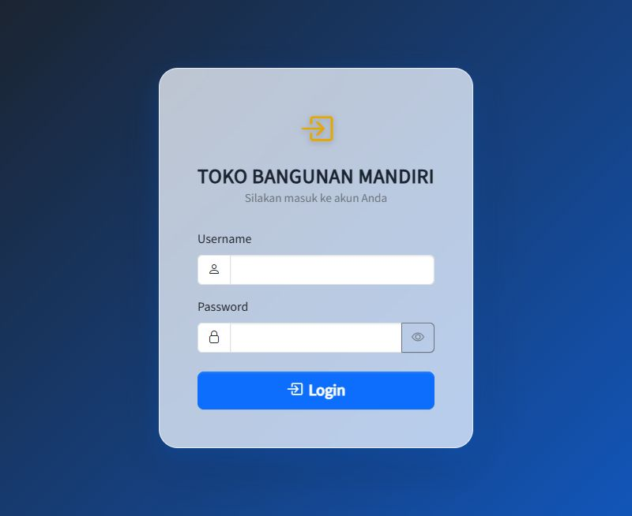
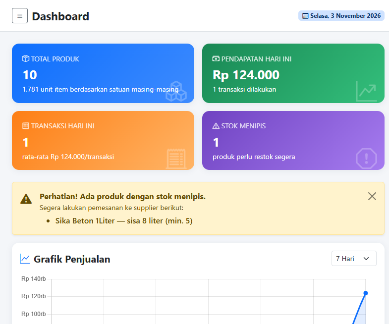
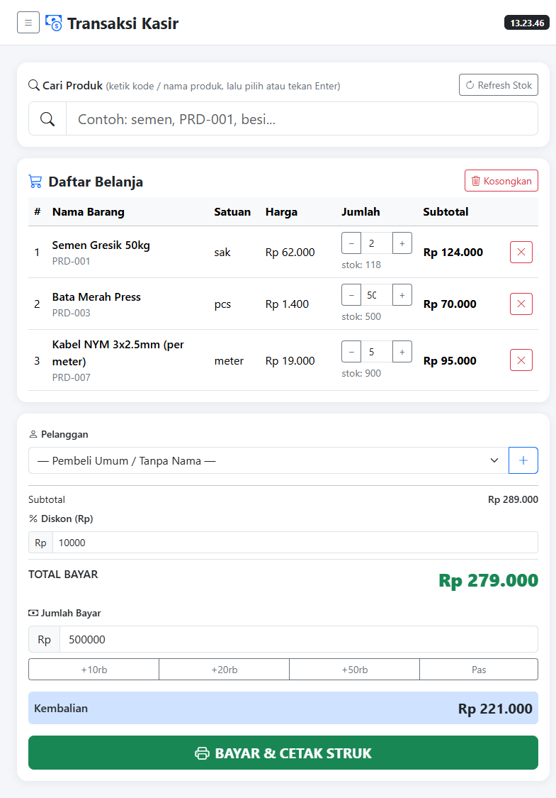
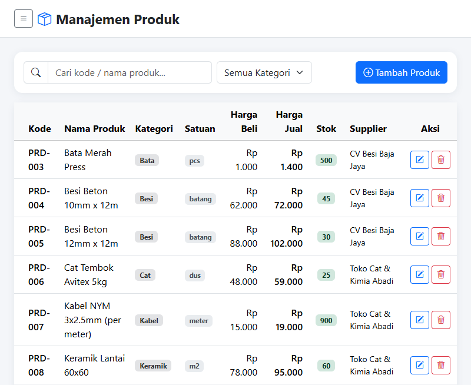
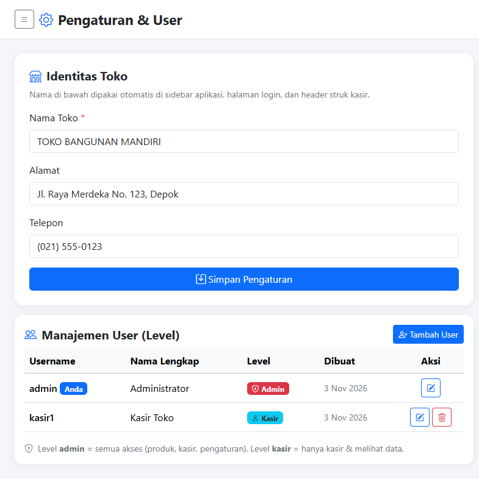
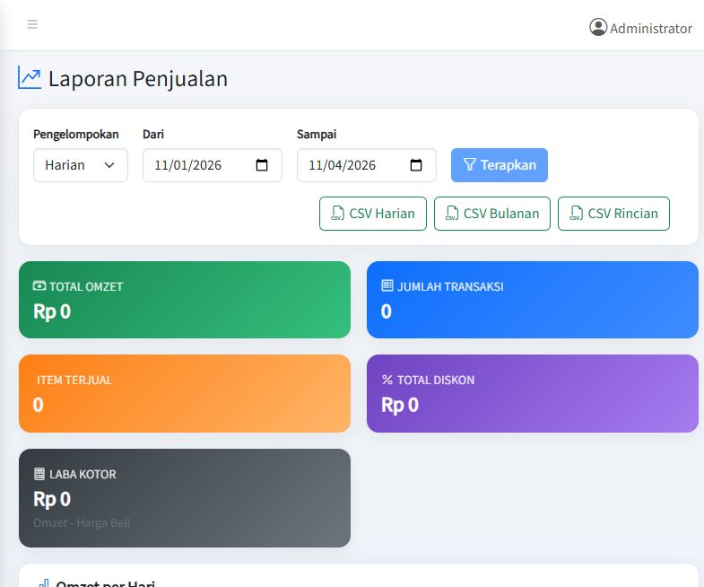
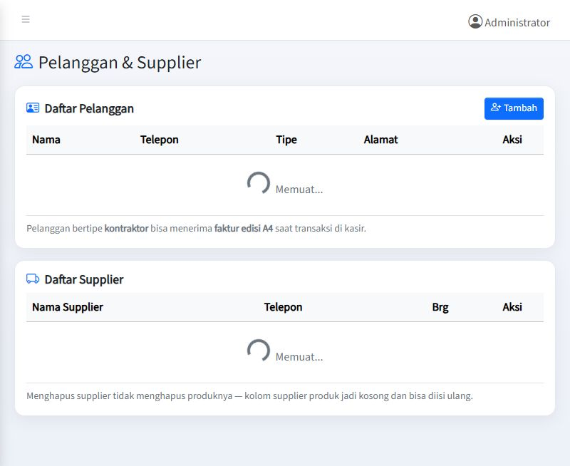

#       🏗️ Toko Bangunan — Aplikasi Penjualan (POS)

Aplikasi kasir &amp; manajemen toko bangunan berbasis web: input penjualan cepat,
stok berkurang **otomatis**, struk siap cetak, faktur A4 kontraktor, laporan +
grafik + export CSV, serta halaman pengaturan nama toko &amp; manajemen user.

> Dibuat dengan **HTML + AdminLTE 4 (Bootstrap 5)** (tampilan), **PHP**
> (server/API), dan **MySQL** (database).

---

## 🖼️ Tampilan Aplikasi

> UI kini memakai **AdminLTE 4** (sidebar + topbar). Screenshot klasik di bawah
> masih dari versi Bootstrap polos — tampilan terbaru serupa, menambah
> menu **Pelanggan &amp; Supplier** dan **Laporan Penjualan**.

### 1. Halaman Login
Satu pintu masuk untuk admin &amp; kasir. Password tersimpan terenkripsi (hash).



### 2. Dashboard
Ringkasan harian: total produk, pendapatan hari ini, jumlah transaksi,
**peringatan stok menipis**, dan grafik penjualan + barang paling laris.



### 3. Kasir (POS)
Cari barang → masuk keranjang → isi diskon &amp; uang bayar → kembalian
terhitung otomatis → cetak struk. Satuan mengikuti barang (sak/pcs/batang/meter).



### 4. Manajemen Produk
Daftar seluruh material: harga beli/jual, stok (badge merah = menipis),
supplier, serta tombol tambah/edit/hapus.



### 5. Pengaturan &amp; User (khusus admin)
Edit **nama/alamat/telepon toko** (otomatis dipakai di seluruh aplikasi dan struk),
kelola akun user beserta **level**-nya, serta tombol **Periksa &amp; Perbaiki** database.



### 6. Laporan Penjualan
Grafik omzet harian, produk terlaris, rincian transaksi, dan **export CSV** siap dibuka Excel.



### 7. Pelanggan & Supplier
Daftar pelanggan (termasuk tipe **kontraktor** yang berhak faktur A4) dan master supplier dengan jumlah produk.



---

## ✨ Fitur

| Fitur | Keterangan |
|---|---|
| 💰 Kasir (POS) | Pencarian barang, keranjang, diskon, **pajak 12%**, kembalian, cetak struk 80mm |
| 🧾 Faktur A4 kontraktor | Pelanggan bertipe *kontraktor* otomatis dapat faktur A4 (selain struk thermal) |
| 📦 Manajemen Produk | Satuan bervariasi: sak, pcs, batang, meter, dus, kg, liter, roll, m², m³ |
| ⚡ Stok otomatis | Stok berkurang sendiri saat transaksi (Trigger SQL), kembali bila dibatalkan |
| 👥 Pelanggan &amp; Supplier | Tipe pembeli (umum/reguler/kontraktor), master supplier + jumlah produk |
| 📊 Laporan Penjualan | Harian &amp; bulanan + rincian faktur + grafik + **export CSV** (siap Excel) + **laba kotor** (omzet − harga beli) |
| 🔄 Retur &amp; Nota Kredit | Retur barang → stok masuk kembali (nota kredit; faktur asal tidak dihapus) |
| 🔔 Notifikasi Stok Menipis | Alert saat stok ≤ batas (email + WhatsApp webhook) |
| 🩺 Diagnostik database | Tombol **Periksa &amp; Perbaiki** (admin): cek DB & trigger stok, biar &amp; perbaiki otomatis |
| 🧮 Laba Kotor | Laba bersih = omzet − harga beli per periode |
| 🔐 Manajemen user | Tambah/edit/hapus akun + level (admin / kasir / **gudang**) |
| 🏪 Identitas toko | Nama, alamat, telepon otomatis dipakai di login, sidebar, dan struk |
| 🖥️ UI AdminLTE 4 | Sidebar, topbar, dropdown user — basis Bootstrap 5, responsif (desktop &amp; HP) |

---

## 🚀 Cara Menjalankan (dengan XAMPP)

> Aplikasi ini butuh **XAMPP** (yang menyediakan Apache, PHP, dan MySQL).
> Belum punya? Unduh gratis di <https://www.apachefriends.org>.

1. **Install lalu buka XAMPP** → klik **Start** pada `Apache` dan `MySQL`.
2. **Salin folder project ini** ke:
   ```
   C:\xampp\htdocs\TokoBangunan
   ```
3. **Buat databasenya** (sekali saja):
   - Buka browser → `http://localhost/phpmyadmin`
   - Menu **Import** → pilih file `db_tokobangunan.sql` → klik **Import**.
   - Selesai! Database `db_tokobangunan` beserta tabel, data contoh, dan
     trigger stok otomatis langsung terbentuk.
4. **Buka aplikasinya**:
   ```
   http://localhost/TokoBangunan/login.html
   ```
5. Login menggunakan akun demo di bawah. 🎉

> Punya database lama dari versi sebelumnya? Jalankan saja `upgrade_v2.sql`
> untuk menambah tabel pengaturan tanpa merusak data.

---

## 🔑 Akun Demo

| Level | Username | Password |
|---|---|---|
| Admin (akses penuh) | `admin` | `admin123` |
| Kasir (hanya kasir) | `kasir1` | `kasir123` |

### Hak akses per level

| Aksi | Admin | Kasir | Gudang |
|---|:---:|:---:|:---:|
| Transaksi kasir / cetak struk | ✅ | ✅ | ✅ |
| Lihat dashboard &amp; daftar produk | ✅ | ✅ | ❌ |
| Lihat &amp; export laporan | ✅ | ✅ | ✅ |
| Tambah pelanggan (untuk POS) | ✅ | ✅ | ❌ |
| Tambah/edit/hapus produk | ✅ | ❌ | ❌ |
| Kelola master pelanggan &amp; supplier | ✅ | ❌ | ❌ |
| Pengaturan nama toko | ✅ | ❌ | ❌ |
| Tambah/edit/hapus user | ✅ | ❌ | ❌ |
| Diagnostik &amp; perbaiki database | ✅ | ❌ | ❌ |

---

## 📂 Struktur Folder

```
TokoBangunan/
├── login.html              # Halaman login (AdminLTE)
├── dashboard.html          # Ringkasan + grafik (Chart.js)
├── kasir.html              # Transaksi kasir + struk 80mm + faktur A4
├── produk.html             # Master produk (CRUD)
├── pelanggan.html          # Master pelanggan & supplier
├── laporan.html            # Laporan harian/bulanan + grafik + export CSV
├── pengaturan.html         # Identitas toko + manajemen user + diagnostik DB
├── includes/
│   ├── config.php          # Koneksi database, session, pengaman role
│   └── dbhealth.php        # Kesehatan DB: status & perbaikan otomatis
├── api/                    # "otak" aplikasi (PHP)
│   ├── login.php / logout.php / me.php
│   ├── produk_list / produk_simpan / produk_hapus .php
│   ├── pelanggan_list / pelanggan_simpan / pelanggan_hapus .php
│   ├── supplier_list / supplier_simpan / supplier_hapus .php
│   ├── penjualan_simpan.php     # simpan transaksi (pajak 12% dari tabel pengaturan, aman, 1x klik)
│   ├── dashboard.php            # data ringkasan & grafik
│   ├── laporan.php              # laporan harian/bulanan/detail + terlaris
│   ├── laporan_laba.php         # laporan laba kotor (omzet - harga beli)
│   ├── laporan_export.php       # unduh laporan sebagai CSV (BOM UTF-8)
│   ├── cek_database.php         # status kesehatan DB (publik)
│   ├── perbaiki_database.php    # buat ulang trigger/akun (admin)
│   ├── pengaturan.php           # nama/alamat/telepon toko + tarif pajak (default 0.12)
│   ├── retur_simpan.php         # retur / nota kredit (stok masuk kembali)
│   └── user_list / user_simpan / user_hapus .php
├── db_tokobangunan.sql     # build database (import dulu!)
├── upgrade_v2.sql          # patch utk database lama
├── test_pengujian.php      # 77 test otomatis (semua PASS)
└── docs/img/               # screenshot untuk README ini
```

💡 **Mengganti koneksi database?** Edit bagian atas `includes/config.php`
(host, nama database, user, password MySQL Anda).

---

## 🛡️ Yang Sudah Dijamin Aman

- **Stok tidak bisa "bocor"** — pengurangan stok dikerjakan oleh *trigger* di
  database sendiri, bukan oleh kode PHP, jadi tidak ada jalur terlewat.
- **Stok kurang saat dikasir?** Transaksi langsung ditolak dengan pesan jelas,
  tidak ada data masuk setengah-setengah (database transaction + rollback).
- **Riwayat faktur tetap akurat** — pelanggan yang sudah pernah bertransaksi
  ditolak untuk dihapus (FK RESTRICT), jadi faktur lama selalu menunjuk
  orang yang benar, bukan berubah jadi "Pembeli Umum".
- **Kasir tidak bisa mengubah master** — semua pengaturan & produk hanya untuk
  admin (dicek server, bukan cuma menu yang disembunyikan).
- **Harga tak bisa dipalsukan** dari sisi browser — total dihitung ulang di
  server dari harga resmi di database.
- **Database bisa pulih sendiri** — tombol "Periksa & Perbaiki" membuat ulang
  trigger stok, tabel pengaturan, dan akun default bila ada yang hilang.
- **Password di-hash** (`bcrypt`), semua query pakai *prepared statement*
  (aman dari serangan SQL injection).

---

## 🧪 Menguji Sendiri Aplikasi

Workspace ini dilengkapi **77 test otomatis** yang menguji semua fitur:
login, CRUD produk, transaksi + pajak 12% + trigger stok, dashboard, laporan +
laba kotor + CSV, pelanggan/supplier, pengaturan, user (level gudang), retur,
notifikasi stok, dan diagnostik database (termasuk simulasi trigger hilang →
perbaikan otomatis). Status terakhir: **77 PASS / 0 GAGAL**.

```bash
# 1. Pastikan MySQL & server PHP aktif
# 2. Reset database ke data awal (opsional tapi disarankan)
mysql -u root < db_tokobangunan.sql

# 3. Jalankan test
php test_pengujian.php
```

---

## ❓ Masalah Umum

| Gejala | Solusi |
|---|---|
| "Koneksi database gagal" | Pastikan MySQL di XAMPP sudah **Start**, cek user/password di `includes/config.php` |
| Halaman putih kosong | Apache belum start, atau folder belum di `htdocs` |
| Login salah terus + banner "Perlu Perbaikan Backend" | Banner di login menjelaskan kendala persis (DB belum ada/tabel kurang). Import `db_tokobangunan.sql`, atau login admin → **Pengaturan → tombol Periksa & Perbaiki** |
| Stok tidak berkurang | Trigger hilang (mis. hasil import parsial) → tombol **Periksa & Perbaiki** membuat ulang 3 trigger stok otomatis |
| Hapus pelanggan ditolak | Memang disengaja: pelanggan yang sudah pernah bertransaksi dilindungi FK RESTRICT agar faktur lama tetap menunjuk orang yang benar |
| Struk kosong saat cetak | Gunakan tombol **Cetak Struk** pada pop-up sukses (bukan Ctrl-P browser) — Ctrl+P sengaja diblokir agar tidak mencetak layar kosong; faktur A4 justru muncul otomatis untuk pelanggan kontraktor |
| CSV rusak di Excel | File CSV dihasilkan dengan BOM UTF-8 + pemisah koma; jangan edit dulu di notepad "save as ANSI" |

---

## 🗺️ Rencana Pengembangan

- [x] Menu **Pelanggan &amp; Supplier** (list, tambah, edit, hapus)
- [x] Halaman **Laporan Penjualan** lengkap (harian/bulanan/rincian + export CSV)
- [x] Struk edisi **faktur A4** khusus kontraktor
- [x] Diagnostik database + tombol **Periksa &amp; Perbaiki**
- [x] Tampilan **AdminLTE 4** (sidebar, topbar, tema Bootstrap 5)
- [x] Notifikasi stok menipis (mis. kirim WhatsApp/email) — via email + webhook
- [x] Retur &amp; nota kredit (stok masuk kembali otomatis, bukan hapus faktur)
- [x] Multi-outlet / peran gudang — level user `gudang` (warehouse)
- [x] Laporan laba kotor (harga beli vs jual per periode)
- [x] Pajak 12% per transaksi (tarif dari tabel pengaturan `pajak`)
